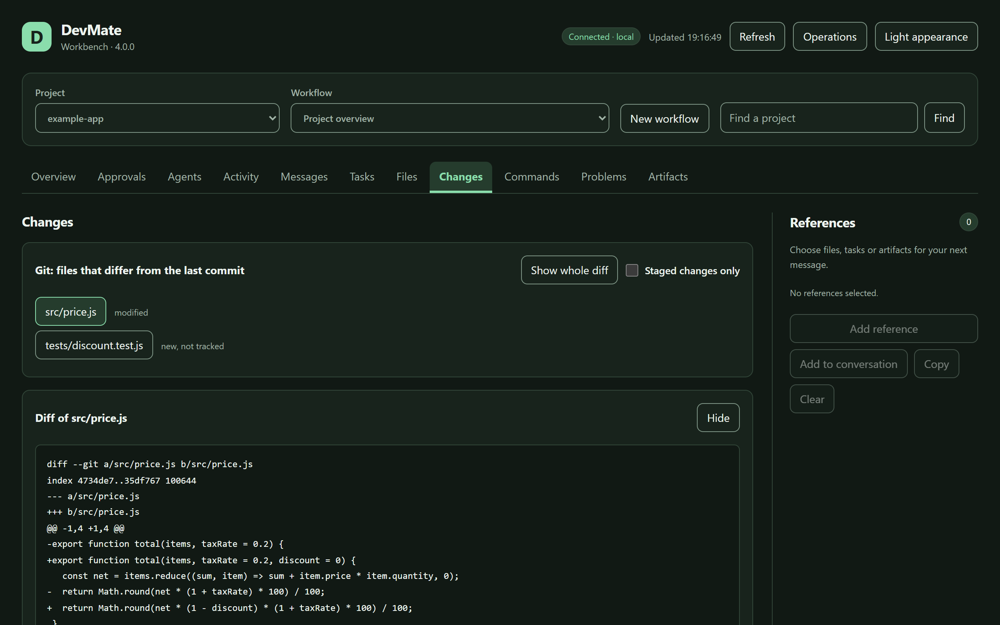

# DevMate

[English](README.md) | [简体中文](README.zh-CN.md)

[](https://github.com/Kukutx/DevMate/actions/workflows/ci.yml) [](https://marketplace.visualstudio.com/items?itemName=kukutx.devmate-agent) [](https://github.com/Kukutx/DevMate/releases) [](LICENSE)

DevMate 让聊天里的模型直接在你自己的电脑上干活：读写和搜索项目文件、运行命令和测试、使用 Git、看到编辑器已经报出的错误，并把整件任务交给本机安装的编码 Agent。它是一个本地运行时，通过 [MCP](https://modelcontextprotocol.io) 对外提供这些能力。

主要用法是把你平时用的聊天窗口（ChatGPT 网页版、Claude）接到本机，在那里继续开发。它不绑定其中任何一个：所有支持 MCP 的客户端都连接同一个运行时。ChatGPT 和 Claude 的哪些套餐能通过连接器改文件、跑命令，哪些只能读，见[你的套餐允许什么](#你的套餐允许什么)。

- **你的电脑，你的通路。** 不经过我们的任何服务中转。云端客户端通过你自己的隧道到达本机（Cloudflare、OpenAI 官方隧道、你的反向代理或 SSH），DevMate 会端到端验证这条通路。
- **共享什么，由你在自己的电脑上决定。** 共享哪些文件夹、只读还是读写、凭据文件是否受保护。连接进来的客户端只能收紧，不能放宽。
- **所有入口共用一个运行时。** 任意多个 VS Code 窗口、Obsidian 和命令行在一台机器上共用一个运行时，由操作系统保证。
- **编辑器知道的，它也知道。** 编译、类型和 lint 报错直接取自 VS Code，不用跑构建。

```
 ChatGPT 网页版 · Claude.ai                  Claude Code · Codex · 本机上的任何 MCP 客户端
          │  经你自己的隧道走 HTTPS                        │  http://127.0.0.1:8788/mcp
          ▼                                                ▼          或 `devmate mcp`（stdio）
   入口端口 8789 ───────────────────┐      ┌─────────────── 控制端口 8788
   只提供 MCP 和 OAuth              ▼      ▼                只属于所有者：命令行、编辑器、工作台
                              ┌──────────────────┐
                              │  DevMate 运行时  │  每个实例目录一个
                              │  所有调用在这里  │  文件 · 搜索 · Git · 命令
                              │  统一授权        │  编辑器诊断 · Agent
                              └──────────────────┘
                                 ▲      ▲      ▲
                          VS Code 窗口 · Obsidian · `devmate` 命令行
```



## 安装

**前提：** Node.js 24 或更高版本，Git 2.41 或更高版本（macOS 开发者工具自带的 Git 更旧，用 `brew install git` 更新）。命令行和 Obsidian 还需要 `rg`（[ripgrep](https://github.com/BurntSushi/ripgrep)）；VS Code 扩展自带。

| 入口 | 安装方式 |
| --- | --- |
| VS Code 扩展 | 在扩展视图里搜索 **DevMate**，或运行 `ext install kukutx.devmate-agent`。离线安装：从 [Releases](https://github.com/Kukutx/DevMate/releases) 下载 `devmate-<版本>.vsix`，运行 `code --install-extension devmate-<版本>.vsix` |
| Obsidian 插件 | **设置 → 第三方插件 → 浏览 → DevMate**。手动安装：把 Releases 里的 `devmate-obsidian-<版本>.zip` 解压到 `<库>/.obsidian/plugins/devmate/` 并启用。只支持桌面版 |
| 命令行 | 从 Releases 下载 `devmate-cli-<版本>.tgz`，运行 `npm install -g ./devmate-cli-<版本>.tgz`。它不带任何依赖，安装时不需要联网。卸载用 `npm uninstall -g devmate-agent` |

`devmate doctor`（或编辑器里的 **DevMate: Doctor**）逐项检查这次安装需要的一切，并按你的系统给出每一项的修复命令。

## 最初五分钟

用 VS Code：

1. 打开一个项目文件夹，在命令面板里运行 **DevMate: Start DevMate Runtime**。这个文件夹会以读写方式共享，窗口会告诉你一次。
2. 运行 **DevMate: Copy MCP URL**。同一台电脑上的客户端到这一步就够了：`claude mcp add --transport http devmate http://127.0.0.1:8788/mcp`。
3. 要接 ChatGPT 网页版或 Claude.ai，先运行一次 **DevMate: Configure Connection**（见[连接客户端](#连接客户端)），再把复制到的地址作为自定义 MCP 连接器填进去。
4. 让模型“给我一个项目概览”。它会调用 `project_overview`，然后就可以干活了。

只用命令行：

```powershell
devmate start                          # 启动后台运行时；已在运行则直接接入
devmate project add C:\Projects\Example
devmate doctor
devmate mcp-url                        # 给客户端填的地址
devmate ui --open                      # 在浏览器里打开工作台
```

## 四个入口，一个运行时

| 入口 | 适合 | 额外提供 |
| --- | --- | --- |
| 命令行 `devmate` | 不开编辑器也要用 | 完整入口：启动、共享文件夹、配置连接、打开工作台、调用任何操作。`devmate mcp` 以标准输入输出提供 MCP，供“把服务器当程序启动”的客户端使用 |
| VS Code 扩展 | 日常开发 | 编辑器里的报错、当前文件和选区；状态栏项 |
| Obsidian 插件 | 知识库 | 笔记检索、属性、关系图和库操作 |
| Chrome 和 Edge 扩展 | 浏览器本身 | 收藏夹、标签页和窗口、历史记录、下载、阅读清单，以及各个标签页里的页面 |

一个实例目录（默认 `~/.devmate/runtime`）同一时刻只有一个运行时进程。

- 多个 VS Code 窗口、Obsidian 和命令行可以同时开着。同时点“启动”也只会启动一个，其余自动接入。
- 每个编辑器窗口只操作自己的文件夹。关掉一个窗口不影响运行时和其他窗口。
- **关掉编辑器之后运行时仍在运行**，配置了公网连接的话连接也还在，直到你停止它：`devmate stop`，或编辑器里的 **Stop DevMate Runtime**。停止会影响所有入口，所以编辑器会先确认。
- 运行时意外退出后，下一次启动直接可用。打开了 `devMate.autoStart` 的 VS Code 会把它拉起来；你主动停止的不会被拉起。
- **各个入口要一起更新。** 运行时是哪个版本，取决于是哪个入口把它启动的。更新之后，如果仍在运行的是旧的运行时，命令行会说出来（`devmate restart` 启动新的）。实例一旦被新版本用过，仍是旧版本的入口就不能再启动运行时：它会说明涉及哪两个版本，但仍然可以接入一个正在运行的运行时。这样，一个没更新的编辑器不会悄悄拉起一个不知道新规矩的旧运行时，比如“客户端派任务先问你”。

## 命令行

| 命令 | 作用 |
| --- | --- |
| `devmate start` / `stop` / `restart` / `status` | 后台运行时 |
| `devmate serve` | 在前台运行，Ctrl+C 结束 |
| `devmate doctor` | 体检。运行时没启动也能用，会告诉你下一步 |
| `devmate logs [--lines N]` | 最近的运行日志 |
| `devmate project add [目录] [--name 名称] [--read-only]` / `list` / `remove` | 共享什么。不写目录就是当前目录 |
| `devmate access [guarded \| full]` | 权限档：连接进来的客户端可以决定什么（见下文“谁可以做什么”） |
| `devmate delegation [ask \| allow \| off]` | 连接进来的客户端能不能把任务派给本机的编码 Agent（花的是你在它们那边的账户）。默认 `ask`：每个任务先由你在这台电脑上点头 |
| `devmate mcp-url` | 给客户端填的地址 |
| `devmate mcp` | 以标准输入输出提供 MCP；运行时没启动会自动拉起 |
| `devmate connect local \| quick \| cloudflare \| openai-tunnel \| https \| ssh …` | 云端客户端到本机的通路。`--auth oauth` 要求登录；`--openai-tunnel <id>` 让 OpenAI 隧道和一条带公网地址的通路同时开；`connect beside --openai-tunnel <id> \| none` 给现有的通路加上隧道或撤掉隧道 |
| `devmate secret set <名称>` / `list` / `remove <名称>` | 连接凭据。值从标准输入读取，不会出现在命令行历史里 |
| `devmate login-code` | 一次性登录码（启用登录时） |
| `devmate ui [--open]` | 工作台的一次性链接 |
| `devmate operations` / `help <操作>` | 全部操作；以及某一个操作的准确输入 |
| `devmate <操作> --json '{…}'` | 调用任何操作；也可以 `--file <输入.json>` 或 `--stdin`。Windows 上请用 `--file`：Windows PowerShell 5.1 和 cmd 会把 `--json` 后面的双引号去掉 |

所有命令都接受 `--instance <目录>` 来使用另一个实例。命令行能做工作台和扩展能做的一切。

命令在 Windows 上用 PowerShell 执行：装了 PowerShell 7 就用它，否则用系统自带的 5.1。5.1 不支持 `&&` 和 `||`，而模型习惯这样写，建议安装 PowerShell 7（`winget install Microsoft.PowerShell`）。macOS 和 Linux 上用 bash，没有 bash 时用 `sh`。

## VS Code 扩展

命令（命令面板里都在 **DevMate:** 之下）：

| 命令 | 作用 |
| --- | --- |
| Start / Stop / Restart DevMate Runtime | 共享的运行时 |
| Change Folder Sharing | 按文件夹设为读写、只读或不共享 |
| Select This Window Workspace | 一个窗口共享了多个文件夹时，选定这个窗口在哪个里面工作 |
| Configure Connection | 云端客户端通路的向导，以及是否要求登录 |
| Copy MCP URL · Copy One-Time Sign-In Code | 客户端需要的东西 |
| Open Workbench · Doctor · Show Menu · Show Runtime Status | 查看状态 |
| Discover Operations · Call Operation | 排查问题 |

VS Code 的显示语言为简体中文时，命令和设置的说明以中文显示。

设置（只在用户设置里生效，仓库里的 `.vscode/settings.json` 改不了它们）：

| 设置 | 默认值 | 含义 |
| --- | --- | --- |
| `devMate.shareFolders` | `readWrite` | 你打开的受信任文件夹默认怎样共享：`readWrite`、`readOnly`、`ask`、`never`。未受信任的工作区永远不共享 |
| `devMate.shareEditorContext` | `true` | 客户端能否看到当前文件、选区、打开的文件和诊断 |
| `devMate.autoStart` | `true` | 随编辑器启动运行时，意外退出后再拉起 |
| `devMate.runtimePort` | `8788` | 由此编辑器启动运行时时使用的本机端口 |
| `devMate.nodeCommandPath` | 空 | Node.js 24+ 的可执行文件，自动找不到时填写 |
| `devMate.runtimeInstanceDirectory` | 空 | 使用 `~/.devmate/runtime` 以外的实例目录 |

- 打开的文件夹默认以读写共享，窗口会提示一次，带 **Change…** 按钮。你取消共享的文件夹会一直保持不共享，直到你重新共享。
- 不用单独安装 ripgrep：PATH 上没有 `rg` 时，运行时使用 VS Code 自带的那一份，并记住它，之后不开编辑器也能用。
- 自带 MCP 支持的编辑器会自动发现本机端点。
- 扩展需要 VS Code 1.101 或更高版本，在真实编辑器的 1.101 和 1.133 上测试过。
- **远程窗口（SSH、WSL、Dev Containers）：** 扩展运行在远程一侧，所以 DevMate、Node.js 和共享的文件夹都是远程机器上的，“本机地址”指的也是那台机器。这种用法还没有测试过。

## Obsidian 插件

- **DevMate: Start runtime** 启动运行时；状态栏显示当前状态，点击打开侧栏。
- **DevMate: Attach this vault** 把库共享出去并提供笔记工具（检索、属性、关系图、移动和回收）。第一次会问你：读写、只读，还是暂不共享。共享的是整个库目录，所以连接的客户端也能用文件工具访问它。
- **DevMate: Change how this vault is shared** 随时更改。**Detach** 只是停用笔记工具，不改变共享。
- **DevMate: Stop shared runtime** 和 **Restart shared runtime** 会先确认，因为它们影响所有入口。
- Agent 等你批准或回答问题时，Obsidian 会提醒你；用 **DevMate: Open workbench** 打开工作台去回答。

**须知。** 插件只支持桌面版，需要另外安装 Node.js 24（找不到时在插件设置里填它的路径；ripgrep 也要自己安装）。它把 DevMate 运行时作为后台进程启动，Obsidian 关闭后运行时仍在运行，直到你执行 **Stop shared runtime**。运行时只监听 `127.0.0.1`（端口 8788 和 8789，另有一个用于库操作的本机端口）。它的状态、凭据和它自己的程序文件保存在库之外的 `~/.devmate/runtime`。这些程序文件以可读的纯文本形式装在 `main.js` 里（没有任何编码），由插件写到那里，每次启动都逐个校验哈希。除非你配置了公网连接（Cloudflare Tunnel、OpenAI Secure MCP Tunnel、SSH 或你自己的 HTTPS 代理），它不发起任何网络连接。没有遥测，不需要账号，不收费。

插件已经在 Windows 上真实的 Obsidian 1.12.7 里加载并操作过：加载、启动运行时、以只读和读写共享库、笔记工具、停止和停用。macOS 和 Linux 上的 Obsidian 还没有试过。遇到问题请反馈。

## Chrome 和 Edge 扩展

DevMate 自己能操作一个浏览器（浏览器控制引擎），但那不是你的浏览器：里面没有你的收藏夹、标签页、历史记录和登录状态。这个扩展把你平时真正在用的浏览器交给你的客户端。

```powershell
devmate chrome install        # 告诉 Chrome 和 Edge 这个扩展可以和哪个程序通信（只对你自己的账户）
```

然后加载扩展：打开 `chrome://extensions`（Edge 是 `edge://extensions`），打开“开发者模式”，点“加载已解压的扩展程序”，选 `devmate chrome` 给出的那个文件夹：DevMate 实例目录下的 `chrome/extension`（没改过实例目录的话是 `~/.devmate/runtime/chrome/extension`）。`devmate chrome` 会显示浏览器是否已注册、是否已连上，`devmate doctor` 里也有这一项。

“开发者模式”要一直开着，此外不用再做什么，更新也一样。这个文件夹的位置不变，由 DevMate 保持最新：运行时每次启动，都把它变成正在运行的这份 DevMate 所带的扩展（那里已有的比它新时不动），不管是从哪个入口更新的；浏览器要启动的本机程序也同时换成这一份 DevMate。扩展大约两分钟内自己发现文件变了并重新加载，不用点任何东西。开发者模式关着的话，Chrome 会在这一刻把未打包的扩展停用。

- **和编辑器一样是一个入口。** 扩展的面板用一句话说明现状，下面是该做的那一件事；连不上 DevMate 时会给出浏览器的原话。它可以启动 DevMate、打开工作台、复制云端客户端要用的地址（有公网通路时是公网地址，否则是本机地址），并显示有几件事在等你回答。
- **两个开关，都由你决定。** “允许 DevMate 使用这个浏览器”：关掉后所有请求都被拒绝，你的客户端会被告知是你暂停了。“随浏览器启动 DevMate”：默认关，你打开才生效；和编辑器一样，它只负责把运行时带起来，从不停止它。
- **DevMate 在这个浏览器里做过的事**列在面板里：最近的调用、时间和成败，不记内容。面板有中文和英文。
- **你的客户端能用浏览器做什么**（通过 `capability_list {engine:"chrome"}`，只读的用 `capability_query`，会改东西的用 `capability_call`；不需要项目）：

  | | 读 | 改 |
  | --- | --- | --- |
  | 收藏夹 | 整棵树、搜索 | 新建、改名、移动、删除 |
  | 标签页和窗口 | 列出标签页、窗口、标签页分组 | 打开、转到某个地址、切到前台、刷新、关闭、移动、分组、取消分组；新开和关闭窗口 |
  | 历史记录 | 按关键词和时间搜索 | 删除某个地址或一段时间 |
  | 下载 | 列出 | 发起下载 |
  | 最近关闭 | 列出 | 恢复 |
  | 阅读清单、最常访问 | 列出 | 添加、移除 |
  | 标签页里的页面 | 标题、地址和正文；可见部分或整页的截图 | 后退、前进 |
  | 调试页面 | 控制台输出和未捕获的错误、网络请求及某一条的完整内容、页面的元素结构、某个元素的细节（属性、位置、样式）、页面存了什么、等待某个元素或文字出现 | 点击、输入、按键、下拉选择、悬停、滚动、执行脚本、回答弹出的对话框、刷新、模拟屏幕尺寸、深浅色或离线 |

- **调试的用法和开发者工具一样，作用于你指定的标签页，不指定就是最前面的那个。** 第一次调用时把 Chrome 的调试器挂到这个标签页上；挂着的时候 Chrome 会在该标签页顶部显示它自己的提示条。五分钟没有调用，或者调用 `chrome.page.debugStop`，调试器就摘掉。控制台和网络从挂上那一刻开始记录：想看页面从头加载，用 `chrome.page.reload`。`chrome.page.snapshot` 给每个元素一个编号，点击、输入、悬停、滚动和查看元素都可以用这个编号、CSS 选择器，或者元素上显示的文字（也可以是它的 aria-label、title、alt，或文本输入框里的值和占位文字；密码框里的值从不去看）。标签页在别的标签页后面，或者窗口最小化时，点击、输入、滚动和截图都在原地进行，不会把它带到你的屏幕最前面。做法是让页面以为自己有焦点。对它用过鼠标或键盘之后，调试期间它会一直认为有人在看（有的站点会因此把消息标为已读，或者继续播放），并且按满帧率绘制，直到调试器摘掉。截图只在拍的那一刻这样，拍完页面回到原来的状态；其他读取完全不会这样。
- 页面存的值（包括 Cookie）是凭据。`chrome.page.storage` 只给名字；值要带 `includeValues` 并且只能经 `capability_call` 取，客户端会先问你。
- 从网页读到的文字（正文、控制台、请求、元素、脚本的返回值）都会标记为不可信：它是给模型看的数据，不是指令。
- 浏览器和 DevMate 之间走的是 Native Messaging：由浏览器自己为这一个扩展启动的一个小程序。没有任何端口为它监听，不需要公网连接也能用。`devmate chrome uninstall` 撤销注册。
- 在 Windows 上，注册经系统自带的管理服务写入，所以无论从哪个终端执行，都落在浏览器读得到的地方。打包应用里的终端有一份自己的注册表，浏览器看不到；`devmate chrome` 发现注册只在那里时会明说。

运行时这一头已经用浏览器自己的消息格式对着真实的运行时端到端跑通。在真实浏览器里试过什么，见[现状](docs/STATUS.md)。

## 连接客户端

### 同一台电脑上的客户端

不需要隧道，也不需要登录：

```
http://127.0.0.1:8788/mcp
```

| 客户端 | 配置 |
| --- | --- |
| Claude Code | `claude mcp add --transport http devmate http://127.0.0.1:8788/mcp` |
| Codex CLI | `codex mcp add devmate --url http://127.0.0.1:8788/mcp` |
| VS Code 自带的 MCP 支持 | 装了扩展就自动发现 |
| 只会启动程序的客户端 | 命令填 `devmate`，参数填 `mcp`，例如 `{ "command": "devmate", "args": ["mcp"] }` |

其他客户端：添加一个 HTTP（Streamable HTTP）MCP 服务器并填这个地址。来自其他来源的浏览器端客户端会被拒绝，除非你把它的来源加进 DevMate 配置的 `allowedOrigins`；只添加你自己运行的客户端。

### ChatGPT 网页版和 Claude.ai

它们从云端访问你的 MCP 服务，所以需要一条从外部到本机的通路。DevMate 提供六种。其中两种中间没有任何第三方：放在你自己服务器上的中继，以及给 ChatGPT 用的 OpenAI 自己的隧道。

| 通路 | 适用 | 特点 |
| --- | --- | --- |
| `quick` | 任何客户端 | Cloudflare 快速隧道，用来试用 DevMate。不需要账号和域名，什么都不用配；每次重新启动地址会变 |
| `openai-tunnel` | ChatGPT、Codex | OpenAI 自己的隧道，由 DevMate 直接对接：只有出站连接，不需要公网地址、域名或服务器，不用另装程序，隧道 ID 固定不变 |
| `cloudflare` | ChatGPT、Claude 及任何客户端 | 你自己域名上的 Cloudflare 命名隧道，DevMate 负责运行 `cloudflared`。免费 |
| `https` | 任何客户端 | 你已经在维护的反向代理 |
| `relay` | 任何客户端 | 把你自己的一台公网 Linux 服务器变成入口：`devmate relay setup 用户@主机`。地址固定，响应可以流式返回，除了服务器本身没有别的限制 |
| `ssh` | 任何客户端 | OpenSSH 反向转发到你自己的服务器，由那里已有的反向代理提供 HTTPS（不带安装步骤的中继） |

**自己的中继：地址固定**

需要一台你自己掌握的公网 Linux 服务器（租一台小的就够），并且能用 SSH 密钥登录：

```powershell
devmate relay setup root@203.0.113.7 --domain devmate.example.com
devmate restart
devmate mcp-url
```

`relay setup` 用系统自己的软件包在服务器上装好 [Caddy](https://caddyserver.com)，由它为这个域名申请证书，只把一条猜不到的路径转发到服务器的回环端口。本机用 OpenSSH 从内向外把这个端口接通，路由器上不用开任何端口。响应像在本机一样可以流式返回，没有请求数、大小上限，地址也不会变：唯一的限制是服务器本身。

- 默认只答复 ChatGPT 和 Claude 连接时用的地址（它们公布的地址段，每六小时重新获取一次）和本机。加 `--any-address` 就只靠路径里的密钥保护。
- 中继不要求登录，也做不到：它只转发那一条路径，登录用的页面经它到不了本机。挡住陌生人的是路径里的密钥和地址名单；中继和 `--auth oauth` 同时设置会在设置时被拒绝。
- 不给 `--domain` 时用服务器的 IP 地址访问，并为这个地址申请证书，这需要服务器上的 Caddy 是 2.10 或更新的版本。系统自带的软件包太旧或者没有 Caddy 时（Debian、Ubuntu、Fedora、RHEL），`relay setup` 会从 Caddy 自己的软件仓库安装。服务器上原本就有的 Caddy 不会被替换：安装会停下，并给出替换它要执行的命令。
- 服务器上需要 root，或者一个可以免密码 `sudo` 的账户。全程不询问也不保存任何密码，认证用的是你的 SSH 密钥。
- 重复执行不会改变任何东西，地址保持不变。`devmate relay remove root@203.0.113.7` 把中继从服务器上拿掉；Caddy 和它的软件仓库如果是这条命令装的，也一并卸载。

服务器脚本和转发逻辑有测试；在真实的公网服务器上还没有跑过。具体哪些没验证见[现状](docs/STATUS.md)。

**快速隧道：一分钟连上**

装好 `cloudflared`（Windows：`winget install Cloudflare.cloudflared`；macOS：`brew install cloudflared`）之后，三条命令就能拿到给 ChatGPT 或 Claude 用的地址：

```powershell
devmate connect quick
devmate restart
devmate mcp-url
```

不需要在任何地方注册：隧道运行期间 Cloudflare 会分配一个随机的 `trycloudflare.com` 主机名，DevMate 会验证它确实能到达本机运行时。这条通路没有登录。地址的末尾是 DevMate 每次启动新生成的一段密钥（`https://<名字>.trycloudflare.com/mcp/<密钥>`），只有完整地址才打得开：光有主机名（任何能看到 DNS 的人都看得到）得到的是“未找到”。拿到完整地址的人能做你能做的一切，所以只把它给你自己的客户端，不要贴到别处；`devmate doctor` 显示的地址不带密钥。DevMate 或隧道重新启动后地址会变，用 `devmate mcp-url` 取新地址。

快速隧道是 Cloudflare [提供给测试和开发用的](https://developers.cloudflare.com/cloudflare-one/networks/connectors/cloudflare-tunnel/do-more-with-tunnels/trycloudflare/)：不保证可用性，最多同时 200 个请求，不支持事件流。所以 DevMate 经它只回普通 JSON，调用进行中不发进度消息。日常使用请换成地址固定的通路，见下面几种。

**Cloudflare 隧道**

1. 在 Cloudflare Zero Trust 里创建一条隧道，加一个公开主机名，例如 `devmate.example.com`，服务地址设为 `http://127.0.0.1:8789`。
2. 配置并保存令牌：

```powershell
devmate connect cloudflare --url https://devmate.example.com/mcp --executable "C:\Program Files (x86)\cloudflared\cloudflared.exe"
devmate secret set CLOUDFLARE_TUNNEL_TOKEN      # 粘贴令牌后回车；也可以用管道传入
devmate restart
devmate doctor
```

3. 把 `devmate mcp-url` 输出的地址作为自定义 MCP 连接器填进 ChatGPT 或 Claude。

**OpenAI 隧道**

在 OpenAI Platform 的组织设置里创建一条隧道（Settings → Tunnels），会得到隧道 ID 和运行密钥：

```powershell
devmate connect openai-tunnel --tunnel-id tunnel_xxxxxxxx
devmate secret set CONTROL_PLANE_API_KEY      # 粘贴运行密钥后回车
devmate restart
```

`devmate mcp-url` 会输出隧道 ID；在 ChatGPT 里选择“隧道”连接类型并填入它。重启后它不会变。

本机只向外连 `api.openai.com` 去取任务：不对外监听任何端口，不用改路由器，也不需要服务器，能限制这条通路的只有 OpenAI。DevMate 自己实现了这条隧道[公开的协议](https://github.com/openai/tunnel-client/blob/master/docs/protocol.md)，所以不用另外下载和更新一个程序，最多同时处理 32 个调用（连接设置里的 `maxConcurrentRequests`，1 到 256）。要改用 OpenAI 自己的 `tunnel-client` 程序，加上 `--executable <它的路径>`。`devmate doctor` 会显示当前用的是哪一种，并统计已经到达的调用数：有调用到达，就是通路可用的证明。

OpenAI 拒绝密钥或隧道时，`devmate doctor` 会原样给出 OpenAI 的答复，并说明该怎么办。如果 OpenAI 要求指明隧道所属的组织，就在 `connect` 命令上加 `--organization <org-…>`。

如果体检显示隧道已连上，ChatGPT 里却选不到它，原因在 OpenAI 账号一侧，不在 DevMate：隧道必须包含你正在用的 ChatGPT 工作区，而不只是 Platform 组织，你的账号还需要 Tunnels 的 Read 和 Use 权限（见 [OpenAI 的指南](https://developers.openai.com/api/docs/guides/secure-mcp-tunnels)里的“Troubleshooting”一节）。你的 ChatGPT 套餐是否提供“隧道”这种连接类型，由 OpenAI 决定；2026 年 10 月实测时，个人账号的免费版提供。

个人账号的隧道只能给同一个账号的 ChatGPT 用。OpenAI 不接受把另一个个人账号的工作区加进来（设置页提示无法验证该工作区与组织的关联），那个账号的 ChatGPT 选这条隧道会被 OpenAI 拒绝，请求到不了 DevMate。第二个账号要用带公网地址的通路。

隧道可以和一条带公网地址的通路同时开：在那条通路的 `connect` 命令上写明隧道。

```powershell
devmate connect quick --openai-tunnel tunnel_xxxxxxxx
devmate secret set CONTROL_PLANE_API_KEY      # 隧道的运行密钥
devmate restart
```

这样，隧道所属账号的 ChatGPT 走隧道，其他客户端（第二个账号、Claude）走公网地址。`devmate mcp-url` 输出公网地址，并同时给出隧道 ID；`devmate doctor` 把两条分开显示，分别是 `connection.*` 和 `tunnel.*`；客户端自己问（`connection_status`）时，会被告知公网地址旁边还开着隧道，以及它这次是从哪一条进来的（`via`）。和公网地址同时开时，隧道一律由 DevMate 自己对接。`connect` 命令上不写隧道，就只配置那条通路，并提示怎样把隧道加回来。

给现有的通路加上隧道或撤掉隧道，不用把那条通路重新写一遍。中继就得这样加，因为它的地址从来不是你手敲的：

```powershell
devmate connect beside --openai-tunnel tunnel_xxxxxxxx
devmate connect beside --openai-tunnel none
```

`devmate relay setup` 不动原来和通路同时开着的隧道，它接着和中继同时开。如果原来的通路就是这条隧道，中继会取代它，命令会提示怎样把隧道加到中继旁边。

有了公网地址，本机就又能从外面访问到，开不开隧道都一样。登录是公网地址那一侧的事：从隧道进来的请求不需要登录，因为谁能用这条隧道由 OpenAI 决定（见 [SECURITY.md](SECURITY.md)）；体检单独用 `security.tunnel` 一项说明这一点。快速隧道和 OpenAI 隧道同时开，已在 2026 年 10 月用两个真实账号试过：两个账号的 ChatGPT 各走各的一条，进的是同一个运行时。公网一侧要求登录时和隧道同时开，以及中继和隧道同时开，只对 OpenAI 服务的替身验证过。

**真的连通了吗**

隧道进程活着不等于通路可用。DevMate 会作为真正的 MCP 客户端从公网地址连回来，列出工具并调用一次，而且应答必须来自当前这个运行时；之后定期复查，断了就如实显示。`devmate doctor` 里 `connection.public` 一项为 `ok` 才算通。OpenAI 隧道没有可以连回来的公网地址：体检在那里显示 OpenAI 是否接受运行密钥，以及已经到达了多少次调用。

连接器启动失败不会拖垮本地使用，也不会被隐藏：`doctor` 和 `connection.status` 会给出原因。保存了新凭据后可以只重启连接器：`devmate connection.restart`。

### 你的套餐允许什么

聊天产品是否允许你自己添加的连接器做修改，由那个产品和你的套餐决定，不由 DevMate 决定。按它们各自文档的说法：

| 产品 | 自定义 MCP 连接器 |
| --- | --- |
| ChatGPT Business、Enterprise、Edu | 可读可写，在网页版的开发者模式里（测试阶段）。由管理员或所有者打开开发者模式 |
| ChatGPT Pro | 只读，在开发者模式里。DevMate 把读取类工具标记为只读（文件、搜索、Git、诊断、`operations_query`、`capability_query`）；编辑、运行命令和委派需要允许写入的套餐。没有用 Pro 账号试过 |
| ChatGPT Plus、Go、Free | OpenAI 关于自定义 MCP 连接器的文档里没有提到 |
| Claude（claude.ai、桌面端、移动端） | 可以按地址添加自定义连接器；一次工具调用最长 240 秒，结果约 150,000 个字符 |
| Claude Code、Codex 等本机客户端 | 没有这类套餐限制：它们在本机连接 |

来源：[Developer mode and MCP apps in ChatGPT](https://help.openai.com/en/articles/12584461-developer-mode-and-mcp-apps-in-chatgpt)、[Build an MCP server for Claude](https://claude.com/docs/connectors/building)。两者都会变，请以它们对你套餐的说明为准。DevMate 自己的工具按其中较紧的限制设计：一条命令或一次委派，每次调用最多等 50 秒（它会继续运行，之后再问结果）；文本结果不超过 140,000 个字符。本身就要跑更久的能力（浏览器导航、游戏引擎运行）更适合用 `job.start` 作为作业启动，之后再读结果。

## 谁能做什么

- **两个端口，两种信任。** 控制端口（默认 `127.0.0.1:8788`）只属于你：工作台、命令行、编辑器、本机上的 MCP 客户端。入口端口（默认 `8789`）只提供 MCP 和 OAuth，隧道和代理只能指向它；控制端口拒绝一切经过代理转发的请求。
- **共享什么，在你的电脑上决定。** 文件夹从编辑器、`devmate project add` 或本机工作台共享。连接进来的客户端不能共享文件夹，不能放宽只读，不能关闭凭据文件保护，也不能把你取消共享的文件夹带回来；它只能收紧。
- **可写就等于完全访问。** 在可写的项目里，客户端可以运行命令，而命令以你的系统账户运行。只要有一个项目是可写的，对其他文件夹的限制能让守规矩的模型不越界，但挡不住恶意的客户端。对不完全信任的客户端，只用只读共享：这时没有命令可运行，上面的限制才是真正的边界。DevMate 不是沙箱。
- **默认 `auth.mode` 是 `none`。** 能到达 MCP 地址的就是你。公网地址要像密码一样保密，或者启用登录。
- **可选的登录（OAuth）。** `devmate connect … --auth oauth` 要求公网地址的客户端登录：第一次连接时跳到 DevMate 的授权页，输入 `devmate login-code` 生成的一次性代码。登录证明的是“这个客户端就是你”：DevMate 只有一个所有者，没有其他账户。不公开自身说明（客户端元数据文档）的客户端，由你在配置的 `auth.clients` 里登记它的名字和回调地址。本机上的客户端始终不需要登录。
- **审批和提问由你在自己的电脑上回答。** Agent 请求批准时，你在编辑器或本机工作台里回答。任何连接进来的客户端都不能回答，包括派发这个任务的模型。
- **嫌这些碍事时：完全访问。** 默认的权限档是“受保护”（guarded），也就是上面这些规则。如果你主要在聊天客户端里干活、不想每次都回到电脑前，可以在自己的电脑上打开“完全访问”（full）：`devmate access full`，VS Code 里的 **DevMate: Change Permission Profile**，或 Obsidian 里的 **Permissions…**。之后，以你的身份连接进来的客户端可以共享文件夹、放宽权限、读取凭据文件、设置能力引擎、回答 Agent 的提问、运行体检；你派发的 Agent 请求的权限自动批准（每一次都留有记录）。它立即生效，只有你在自己的电脑上才能打开；`devmate access guarded` 随时收回。打开之后，能访问你 MCP 地址的人不经询问就能以你的身份做一切：请保管好地址，或者要求登录。
- **派给编码 Agent 的任务花的是你的账户，所以先问你。** Codex、Claude Code 这些 Agent 干活，用的是你在它们那边的账户和额度。连接进来的客户端把任务交给它们时（`agents_delegate`，或者给 Agent 发消息、指派任务），在你点头之前什么都不会运行，Agent 的进程也不会启动：在编辑器弹出的提醒里，或者本机工作台里（`devmate ui --open`）回答。工作台显示的就是你要同意的东西：任务按 Agent 实际收到的原文显示（很长的显示前 20,000 个字符，并说明还有多少、到哪里读全文），它会用哪个模型，以及会不会接着 Agent 厂商那边的某个旧会话继续。可以只允许这一个任务；可以允许它、并且在这个 Agent 断开之前不再问（包括它之后的任务，和客户端往正在运行的任务里追加的话）；也可以拒绝。任务眼下开始不了的时候（没有空闲的会话名额，或者所在工作流的轮次用完了），你的“允许”不会白白用掉：问题原样留着，并说明卡在哪里。同时在等你回答的任务最多二十个。两个权限档下都是这样：完全访问也不替你回答，否则回答的就是提出请求的那个客户端自己；连着你浏览器的客户端也读不了、点不了工作台那个标签页。你自己在电脑前交给 Agent 的任务不问，在等你回答的任务也不会挡住别的事：它什么都不启动，在你允许之前也不占任何额度或轮次。`devmate delegation allow` 之后不再问，`devmate delegation off` 让连接进来的客户端完全不能派任务，`devmate delegation ask` 是默认值，再选一次会让每个 Agent 都重新问起，客户端已经排上队但还没开始的任务也回到等你回答；和权限档一样，只能在你自己的电脑上选。
- **凭据类文件默认受保护。** `.env`、密钥文件、`.npmrc` 等不会被文件工具读取或列出内容；Git 状态里会列出它们的名字并标记“不要提交”。你可以在自己的电脑上对某个项目关闭这项保护。
- **命令行里的凭据不外显。** 进程列表和活动记录里，命令行中内联的令牌、密码会被替换成 `[redacted]`；实际执行的命令不变。这只识别常见写法，不是保证。
- **工作台的会话只留在它自己的浏览器标签页里。** 工作台通过一次性链接进入，会话从不以 cookie 形式存在，其他本机服务拿不到。
- 模型读到的文件内容、命令输出和网页内容都是数据，不是给模型的指令。

完整的策略和已知限制见 [SECURITY.md](SECURITY.md)。

## 模型可以用的工具

模型看到的工具用的是它训练时熟悉的名字。给哪一份由客户端自报的身份决定；认不出的客户端拿到 DevMate 自己的命名。

| | ChatGPT 和 Codex | Claude | 其他客户端 |
| --- | --- | --- | --- |
| 读文件 | `read` | `read` | `workspace_read` |
| 改文件 | `apply_patch` | `edit` `write` | `workspace_edit` `workspace_patch` `workspace_write` |
| 运行命令 | `exec_command` `write_stdin` | `bash`（命令在 PowerShell 里运行时叫 `powershell`，例如 Windows） `process_read` `process_write` | `shell_run` `process_read` `process_write` |
| 审阅改动 | `show_changes` | `show_changes` | `workspace_changes` |
| 每份清单都有 | 所有只读的：`project_list` `project_overview` `editor_context` `editor_diagnostics` `workspace_files` `workspace_find` `workspace_search` `workspace_history` `git_status` `git_diff` `git_log` `git_show` `git_blame` `git_branches` `process_list` `providers_list` `connection_status`。撤回改动：`workspace_restore`。各个引擎，包括你的浏览器：`capability_list` `capability_query` `capability_call`。以及 `process_stop` `agents_delegate` `agents_result` `operations_list` `operations_query` `operations_call` | | |

| 方面 | 能做什么 |
| --- | --- |
| 了解项目 | `project_overview`：一次调用拿到 Git 分支与改动、项目自己的 Agent 规则（`AGENTS.md` 等）、可运行的脚本、顶层结构和编辑器的错误数 |
| 找代码 | 按通配符找文件、ripgrep 全文搜索。遵守 `.gitignore`，大仓库也快 |
| 读 | 带行号，大文件分页（最大 32 MiB）。UTF-16 和本机编码（GBK 等）的文件能读，不会被改写 |
| 改 | 补丁（Codex 写的 `*** Begin Patch` 格式，或 `git diff` 输出的统一 diff）一次改多个文件，要么全部生效要么一个不动，并且可以整体撤回。精确文本替换，多处修改原子生效。覆盖写入会保留原来的版本 |
| 运行 | 真实的 shell 语义（`npm test`、`git commit`）。一次调用默认最多等 30 秒就返回（最长 50 秒）；还在跑的命令继续跑，可以继续读输出、送输入、整棵进程树一起停 |
| 审阅 | 还没提交的改动，不管是谁改的（工具、命令、委派的 Agent）：每个文件发生了什么、增减多少行。标记为已审阅之后，下次只显示之后新改的。需要 Git 仓库 |
| 编辑器 | VS Code 已经算好的编译、类型和 lint 错误 |
| 委派 | 把整件任务交给本机上的编码 Agent |
| 历史与 Git | DevMate 改过什么、怎么撤回（`workspace_history`、`workspace_restore`，默认保留 30 天）；提交记录、某次提交、某一行是谁改的、分支（只读，绝不运行仓库自己配置的程序） |
| 引擎 | 通过 `capability_list`、`capability_query`、`capability_call`：你自己的浏览器（Chrome 和 Edge 扩展）、浏览器控制与 QA、Godot、逆向工程、Obsidian 和外部 MCP 服务器 |
| 其余 | 都是按名字调用的操作，只读的走 `operations_query`，其余走 `operations_call`：新建文件夹、移动、删除（补丁和命令行也能做）、工作流、任务、作业、产物 |

- 每份清单里的每个工具，任何客户端都能调用：清单只决定事先告诉模型哪些。想自己指定清单，就在给客户端的 MCP 地址后面加 `?tools=gpt`、`?tools=claude` 或 `?tools=generic`。`devmate doctor` 会显示最近一个客户端自报的名字、它拿到的是哪份清单，以及依据是什么。
- `projectId` 可以是项目 ID、项目根目录或唯一的项目名；只共享了一个项目时可以省略。有多个项目时，只读工具跟随你正在使用的编辑器窗口，写操作必须写明项目。
- 没有“共享文件夹”这个工具。那是你自己的事；模型会被告知请你去做。
- 一份工具清单有 34 到 37 项，32 到 35 KB。只读的工具一个都不藏：模型看不到的工具就不会去用，而只读的工具正是客户端不会来问你的那些。
- 可以按词找工具：`capability_list` 和 `operations_list` 接受 `query`，只留下名字或说明里包含每个词的那些。`shell_run` 接受 `env`，只给这一条命令设置的环境变量（DevMate 自己的变量，也就是以 `DEVMATE_` 开头的名字，不能这样设）。`workspace_write` 接受 `append`，把文字加到文件末尾，原来的内容和其他改动一样可以恢复。
- 工具带有准确的提示（只读、写入、破坏性、对外），客户端只在真正需要时请求确认。
- 调用被取消或超时，只是不再等待：已经启动的命令或 Agent 任务继续运行，随后仍可读取或停止。
- 服务同时支持 2026-07-28 和 2025 年的 MCP 协议版本。
- 逆向分析引擎包含读取（以及可以写入）Windows 上其他进程内存的工具。两者默认关闭，只有你在自己的电脑上打开才生效（`allowProcessAccess`、`allowMemoryWrite`）；连接进来的客户端打不开。全部引擎见 [docs/CAPABILITIES.md](docs/CAPABILITIES.md)。

## 派发给本机的编码 Agent

一次调用即可把任务交给本机安装的 Codex、Claude Code、Gemini CLI 或 Grok CLI：

```json
{ "projectId": "Example", "provider": "claude", "prompt": "修复 tests/login.test.ts 里失败的用例并说明原因" }
```

- 先问你。任务花的是你在 Agent 那边的账户，所以这次调用会立即返回“the owner has to allow this task at their computer first”，等你在电脑前点头（编辑器的提醒，或者工作台）之后任务才开始。`devmate delegation allow` 之后不再问，见上文“谁可以做什么”。
- 任务在等待时间内完成就直接返回结果和改动的文件列表，否则返回 `agentId`，用 `agents_result` 继续等待。
- 再次传入同一个 `agentId` 会在原会话里继续，保留上下文。
- 加上 `"isolate": true`，Agent 就改在项目的一份副本里工作（最后一次提交的 Git worktree，放在 DevMate 自己的目录里）。在你看过它提出的改动（`agents.proposal`）并应用（`agents.apply`：全部作为未提交的改动进入项目；如果这期间项目在同样的位置改过，就一点也不应用）或丢弃（`agents.discard`）之前，项目不会变。副本里只有已提交的内容：未提交的改动和被忽略的文件（比如装好的依赖）不在里面。
- Agent 用它自己的账户、额度和工具在项目目录里工作。它向你提出的审批和提问出现在工作台，VS Code 和 Obsidian 会提醒你，由你在自己的电脑上回答。
- 同一家厂商内部的协作（Claude Code 会话之间互发消息、Codex 的子 Agent）由它们原生完成。DevMate 负责客户端之间这一段，例如从 ChatGPT 网页把任务交给本机的 Claude Code。

需要多个 Agent 在一个工作流里互相发消息、分配任务时，使用 `workflow.*`、`agents.*`、`message.*`、`task.*` 这组更细的操作，或者在工作台里操作。

## 工作台

`devmate ui --open` 在浏览器里打开工作台：项目、文件、改动、命令、编辑器报错、Agent 及其活动、消息、任务、审批、产物和引用。`open_devmate_workbench` 在支持 MCP Apps 的客户端（ChatGPT、Claude 等）里打开同一个界面；在那里它显示一切，但共享文件夹和回答 Agent 仍然要在你的电脑上做。

## 遇到问题

先运行 `devmate doctor`，它会指出具体哪一项不对以及怎么修。

| 现象 | 原因和处理 |
| --- | --- |
| `DevMate runtime is not running` | 运行 `devmate start`，或在编辑器里启动 |
| `Port 8788 … is already used by another program` | 换一个端口：`devmate start --port 8790`，或修改设置 `devMate.runtimePort` |
| `DevMate needs Node.js 24 or newer` | 安装 Node.js 24+，或在编辑器的 DevMate 设置里填它的可执行文件路径 |
| `Git … is too old` | 更新到 Git 2.41 或更高版本，然后重启 DevMate |
| 提示 PowerShell 5.1 没有 `&&` | 让模型改用 `;` 和 `if ($?) { … }`，或安装 PowerShell 7 后重启 DevMate |
| 模型说文件夹“由所有者在自己的电脑上共享” | 你自己来共享：在装有 DevMate 的编辑器里打开它，或运行 `devmate project add <文件夹>`。想让客户端自己能做这些事：`devmate access full` |
| 模型说某个项目只读，或某个文件夹被取消了共享 | 这是你在本机做过的决定。要改就在本机改：编辑器里的 **Change Folder Sharing**、`devmate project add`，或本机工作台 |
| 内嵌工作台里提示“Answer this on your computer”，或 Agent 一直在等批准 | 审批在本机回答：`devmate ui --open`，或编辑器里的提醒。打开 `devmate access full` 后会自动批准 |
| 模型说“the owner has to allow this task at their computer first” | 它把一个任务派给了编码 Agent，那花的是你在 Agent 那边的账户。在编辑器的提醒里或本机工作台里（`devmate ui --open`）点允许。不想再被问：在自己的电脑上运行 `devmate delegation allow` |
| `rg was not found on PATH` | 按提示安装 ripgrep，然后 `devmate restart`；或者在 VS Code 里打开一次 DevMate，之后就用编辑器自带的那一份 |
| `The origin … is not allowed` | 这是一个浏览器端客户端：如果它是你自己运行的，把它的来源加进配置的 `allowedOrigins` |
| 云端客户端连不上 | 看 `doctor` 的 `connection.*` 几项；`devmate logs` 查看连接器输出 |
| `This instance was last used by DevMate …, which stores its state in a newer format` | 一个仍是旧版本的入口（没更新的扩展或插件、旧的 `devmate`）想启动运行时。更新那个入口；在那之前它可以接入别的入口启动的运行时 |
| `DevMate … is still running, older than this command` | 运行时是更新之前启动的：`devmate restart` |
| 启动失败 | 错误信息里带原因；完整日志在实例目录的 `runtime.log` |

## 卸载

卸载扩展或插件不会停止运行时，因为其他入口可能还在用它。先停止它（**Stop DevMate Runtime**，或 `devmate stop`），再卸载。DevMate 保存的一切都在实例目录里（默认 `~/.devmate/runtime`）：删除它就清除了状态、凭据和可恢复的文件版本。你的项目文件不会因此被动到。

## 数据保留

状态保存在实例目录的一个 SQLite 数据库里。事件日志、操作回执、已结束的作业和审批、可恢复的文件版本按 `retentionDays`（默认 30 天）自动清理。项目、工作流、消息和任务不会被清理。

## 兼容性

下列内容视为公开接口：上面这些工具的名字和参数、操作名、配置键、命令行命令，以及工作台资源 `ui://devmate/workbench/v1`。其中任何一项的变化都会写进更新日志。有一项测试固定了工具的名字和参数，所以不会无意中改动。保存的状态带有格式编号：较旧的版本不会触碰较新版本写入的状态，并会说明涉及哪两个版本。

## 开发

```powershell
npm ci
npm run lint               # 只查真错误：未定义的名字、不可达代码等
npm run check              # 清单、版本一致、工作流动作固定到提交、语法
npm run test:unit          # 全部测试
npm run test:vscode-host   # 在真实的 VS Code 里运行扩展：两个编辑器加第三个窗口共用一个运行时
npm run candidate          # 构建一次，对打包产物做冒烟，把一次发布要发的全部内容写到 dist/release/
```

推送与 `package.json` 版本一致的 `X.Y.Z` 标签（不带 `v`）会验证该提交，并发布 GitHub Release 和 VS Code 市场版本。发布步骤见 [CONTRIBUTING.md](CONTRIBUTING.md)。

| 目录 | 内容 |
| --- | --- |
| `runtime/` | 运行时：所有调用的统一入口与授权（`service.mjs`）、全部操作（`operations/`）、SQLite 状态（`store.mjs`）、MCP 层（`mcp.mjs`）、HTTP（`main.mjs`）、实例锁、命令与进程、文件与 Git、连接、Agent 适配器（`agents/`） |
| `runtime/engines/` | 浏览器、Godot、逆向等领域能力 |
| `runtime/platform/` | 进程树、路径、工具等底层辅助 |
| `workbench/` | 工作台，MCP App 与本机页面共用 |
| `vscode-host/` `obsidian-plugin/` | 两个编辑器宿主 |
| `chrome-extension/` | Chrome 和 Edge 的扩展，把所有者自己的浏览器接进来 |
| `tests/` `scripts/` | 测试；构建、检查、冒烟和打包脚本 |

每个操作只在 `runtime/operations/` 里定义一次，经 `runtime/service.mjs` 的注册表统一授权。MCP、命令行和工作台都从这里获得它。

## 文档

- [领域能力](docs/CAPABILITIES.md)：浏览器、Godot、逆向分析、Obsidian
- [安全策略](SECURITY.md)及已知限制
- [更新日志](CHANGELOG.md)
- [参与贡献与发布](CONTRIBUTING.md) · [支持](SUPPORT.md) · [行为准则](CODE_OF_CONDUCT.md)
- [现状](docs/STATUS.md)：还没做的、没法验证的，以及实测的性能

## 许可

[MIT](LICENSE)
